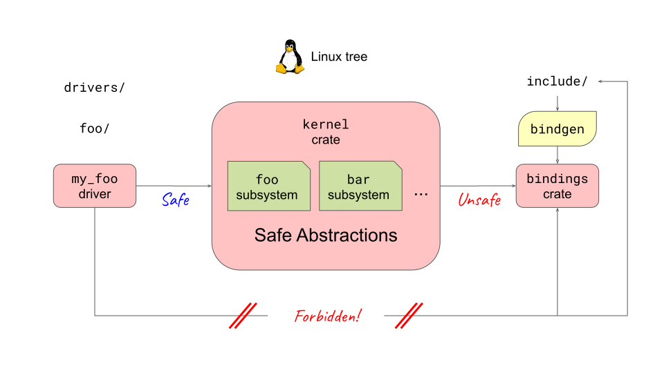

<!--
Copyright 2026 Google LLC
SPDX-License-Identifier: CC-BY-4.0
-->

# Kernel Abstractions

  

- Day 1 focused on *using* safe abstractions in the `kernel` crate (`KBox`, `Mutex`, `CondVar`, `MiscDevice`).
- This section zooms in on the middle layers of the diagram: how `bindgen` generates raw FFI declarations, how `rust/helpers/` bridges `static inline` C functions, and how `rust/kernel/` wraps them in safe types (`Credential`, `File::cred`).

