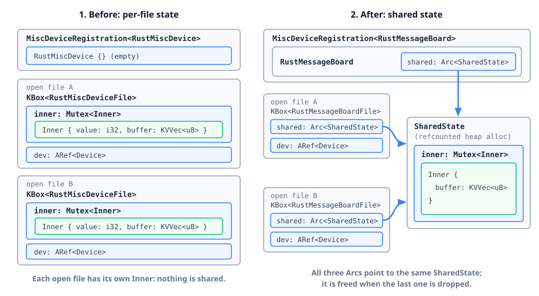

<!--
Copyright 2026 Google LLC
SPDX-License-Identifier: CC-BY-4.0
-->

# Sharing State Across Open Files

To share state across every process that opens the device, we store an `Arc<SharedState>` inside the registration struct and clone it in `open()`:

```rust,ignore
#[pin_data]
struct SharedState {
    #[pin]
    inner: Mutex<Inner>,
}

/// Data shared by all open files for the same instance of this miscdevice.
#[pin_data]
struct RustMessageBoard {
    shared: Arc<SharedState>,
}

/// Data that is stored per file for this miscdevice.
#[pin_data(PinnedDrop)]
struct RustMessageBoardFile {
    shared: Arc<SharedState>,
    dev: ARef<Device>,
}

#[vtable]
impl MiscDevice for RustMessageBoard {
    type File = Pin<KBox<RustMessageBoardFile>>;

    fn open(_file: &File, misc: &MiscDeviceRegistration<Self>) -> Result<Self::File> {
        let dev = ARef::from(misc.device());

        KBox::try_pin_init(
            try_pin_init!(RustMessageBoardFile {
                shared: Arc::clone(&misc.shared),
                dev,
            }),
            GFP_KERNEL,
        )
    }
    // ...
}
```

<p align="center">
   in each open file. After: each open file holds an Arc to one shared SharedState." />
</p>

<details>

- **Live-code / walk through this transformation together on [`samples/rust/rust_misc_device.rs`](https://github.com/Darksonn/linux/blob/rfl-course-edu/samples/rust/rust_misc_device.rs):**
  1. In `init()`, allocate `let shared = Arc::pin_init(try_pin_init!(SharedState { ... }), GFP_KERNEL)?;` and pass `try_pin_init!(RustMiscDevice { shared })` (renamed to `RustMessageBoard` on the slide) to `MiscDeviceRegistration::register`.
  2. Why `Arc<SharedState>` instead of borrowing `&RustMessageBoard` directly in `RustMessageBoardFile`? Because open files can outlive the registration: unregistering a `miscdevice` (e.g. on `rmmod`) only stops *new* `open()` calls, while already-open file descriptors stay valid until user space closes them. The `'static` bound on `MiscDevice::File` is just how the Rust type system encodes this fact.
  3. Point out that this completed shared-buffer starting point is also available in the repository at [`samples/rust/rust_message_board.rs`](https://github.com/Darksonn/linux/blob/rfl-course-edu/samples/rust/rust_message_board.rs) (exposing `/dev/rust-message-board`).
- **Module boilerplate in the starter (mention only as needed):**
  - `impl kernel::InPlaceModule`: unlike `Module::init`, which returns `Result<Self>` by value, `InPlaceModule::init` returns `impl PinInit<Self, Error>`, so the module struct is initialized in place. This is required because it contains the pinned `MiscDeviceRegistration` (the C side keeps a pointer to the embedded `struct miscdevice`).
  - `pin_init::pin_init_scope(|| { ... })` runs the closure first and then the initializer it returns. This lets us do fallible setup with `?` (e.g. `Arc::pin_init(...)?`) before building the final `try_pin_init!(Self { ... })`; an error from the closure makes the whole initializer fail.
  - `MiscDeviceRegistration::register` is `unsafe` because the caller must not `mem::forget()` the registration or otherwise prevent its `Drop` from running. `Drop` calls `misc_deregister`, and the registration data may borrow data with a non-`'static` lifetime (`'a`), so skipping it would leave a registered device pointing at freed memory. Storing it in the module struct, which is dropped on `rmmod`, satisfies this.
- **Lead-in to the exercise:** Right now `Inner` still holds a single `buffer: KVVec<u8>` that every `write_iter` clears and overwrites. Over the next several small milestones, you'll evolve it into a multi-message board with cursors, live streaming, non-blocking reads, and `O_TRUNC` clearing!
- **Demo in QEMU:** Show that the original sample keeps state per open file, while the shared version keeps one buffer that each write overwrites:
  ```bash
  # Before: each open() gets its own buffer, so `cat` sees nothing.
  insmod /mnt/linux/samples/rust/rust_misc_device.ko
  echo "hello" > /dev/rust-misc-device
  cat /dev/rust-misc-device        # (empty)

  # After: all opens share one buffer...
  insmod /mnt/linux/samples/rust/rust_message_board.ko
  echo "hello" >> /dev/rust-message-board
  cat /dev/rust-message-board      # hello
  # ...but each write overwrites the previous message.
  echo "world" >> /dev/rust-message-board
  cat /dev/rust-message-board      # world
  ```

</details>
